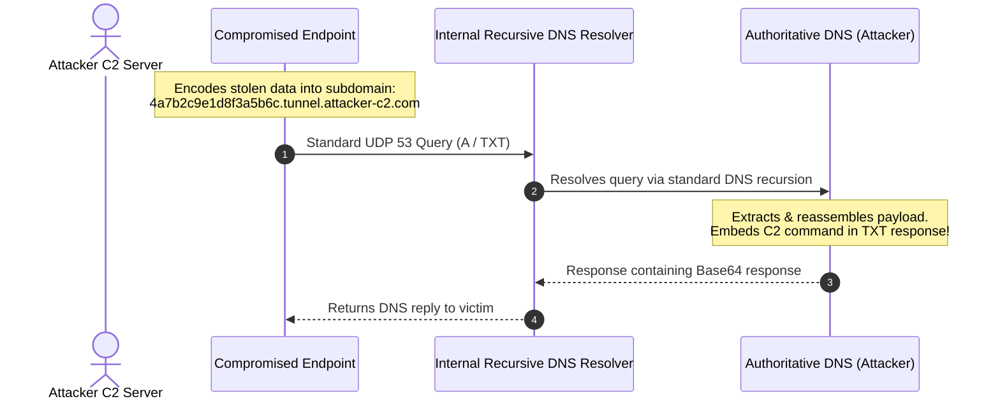

<div align="center">

# 🛡️ DNS Tunneling & Exfiltration Detector

**A High-Performance Security Framework to Detect Covert Channels, Tunneling, and Data Exfiltration in DNS Traffic using Shannon Entropy and Lexical Heuristics.**

[](https://www.python.org/)
[](LICENSE)
[](.github/workflows/ci.yml)
[](requirements.txt)
[](#threat-model)

[English Documentation](README.md) • [Dokumentasi Bahasa Indonesia](README_ID.md)

</div>

---

## 📌 Executive Summary

Domain Name System (DNS) is typically unrestricted in perimeter firewalls, making it one of the most stealthy covert transmission channels used by Advanced Persistent Threats (APTs), ransomware operators, and malware frameworks (such as **dnscat2**, **Iodine**, **Cobalt Strike DNS Beacons**, and custom DNS exfiltrators).

This framework inspects DNS query strings and extracts multi-dimensional statistical, lexical, and volumetric features. By correlating **Shannon Entropy**, **Metric Entropy**, **Subdomain Length**, **Character Distribution (Hex/Base64/Base32/Consonants)**, **Query Type Anomaly**, and **Apex-Domain Cardinality**, the tool reliably flags data exfiltration while maintaining an exceptionally low false-positive rate.

> **💡 Zero External Dependencies Required:** Works out of the box with standard Python 3.8+! Optional extensions (`rich`, `scapy`, `tldextract`) unlock live packet capture and enhanced terminal dashboards.

---

## 🎯 Threat Model & How DNS Tunneling Works

Attackers bypass egress perimeter filtering by encoding arbitrary files, keystrokes, or command-and-control (C2) payloads into DNS query labels directed to an attacker-controlled authoritative name server:



### The Math: Shannon Entropy in DNS

Shannon Entropy measures the degree of unpredictability or information density per character in a string:

$$H(X) = -\sum_{i=1}^{n} P(x_i) \log_2 P(x_i)$$

Where:
- $X$ is the payload string (subdomain label).
- $P(x_i)$ is the probability of character $x_i$ occurring in the string.
- Natural human subdomains (`mail`, `login`, `intranet`) possess low entropy ($\approx 2.0 - 3.2$ bits/char).
- Encrypted or Base32/Base64/Hex payloads exhibit high entropy ($\ge 3.8 - 4.8$ bits/char).

---

## 🚀 Key Features

- **Multi-Factor Scoring Engine (0 - 100):** Replaces rigid rule checks with weighted anomaly correlation across entropy, length, character ratios, and query types.
- **Categorized Alert Severity:** Automatically classifies events into `CRITICAL`, `HIGH`, `MEDIUM`, and `LOW` with actionable SOC triage recommendations.
- **Universal Log Format Support:**
  - 📄 **CSV & TSV:** Intelligent auto-detection of column headers (`query`, `domain`, `client_ip`, etc.).
  - 📋 **JSON & NDJSON:** Zeek JSON, Suricata EVE DNS, Pi-hole FTL, or SIEM exports.
  - 🛡️ **Zeek / Bro TSV:** Native parser for `#fields` formatted `dns.log`.
  - 🌐 **ISC BIND 9:** Server query log formats.
  - 📦 **PCAP / PCAPNG:** Built-in pure-Python PCAP parser (no external library required) + Scapy integration.
- **Live Network Sniffer:** Captures live UDP port 53 traffic on any network interface.
- **Rich Reporting:** Exports detailed reports into **JSON**, **CSV**, **Markdown**, and **Self-Contained Dark-Mode HTML** executive dashboards.
- **Interactive Single-Domain Calculator (`calc` mode):** Instantly diagnose suspect domains during manual triage.
- **Tunable Whitelist:** Built-in protection against false positives from CDNs, telemetry providers, and major cloud services.

---

## 📊 Detection Logic Matrix

| Dimension | Indicator | Threshold / Condition | Risk Contribution |
|---|---|---|---|
| **Entropy** | Shannon Entropy $H(X)$ | $\ge 4.3\text{ bits}$ | **+32 pts (CRITICAL)** |
| | Elevated Entropy | $\ge 3.6\text{ bits}$ | **+22 pts** |
| **Length** | Max Label Length | $\ge 50\text{ characters}$ (RFC max 63) | **+26 pts** |
| | Subdomain Length | $\ge 55\text{ characters}$ | **+18 pts** |
| | Deep Label Count | $\ge 4\text{ labels}$ with sublen $\ge 30$ | **+8 pts** |
| **Encoding** | Hexadecimal Ratio | $\ge 85\%\text{ hex characters}$ | **+18 pts** |
| | Base64 / Base32 | Matched regex payload signature | **+15 pts** |
| | Consonant Density | $\ge 75\%\text{ consonants}$ or $\ge 7\text{ consecutive}$ | **+10 pts** |
| **Query Type** | TXT Channel | TXT record with sublen $\ge 20$ | **+15 pts** |
| | NULL / CNAME Payload | Abnormal payload size on NULL/CNAME | **+12 pts** |
| **Volume** | Apex-Domain Cardinality | $\ge 25\text{ unique subdomains}$ per base domain | **+20 pts** |

---

## 🛠️ Quickstart & Installation

### Option 1: Zero-Dependency Run (Standard Python 3.8+)
Clone the repository and run immediately:
```bash
git clone https://github.com/c0losseum/dns-tunnel-detector.git
cd dns-tunnel-detector
python main.py --help
```

### Option 2: Full Enhanced UI & Live Sniffing
Install optional packages for terminal tables (`rich`) and live packet capture (`scapy`):
```bash
pip install -r requirements.txt
# or install in editable mode:
pip install -e .
```

---

## 💻 Usage & CLI Examples

### 1. Analyze Sample Log Files
Inspect CSV, Zeek, or JSON logs and generate multiple report formats:
```bash
# Analyze sample CSV traffic
python main.py analyze -f samples/dns_tunnel_sample.csv

# Export findings to an HTML incident dashboard and CSV file
python main.py analyze -f samples/dns_tunnel_sample.csv \
  --output-html reports/incident_report.html \
  --output-csv reports/alerts.csv \
  --output-json reports/alerts.json
```

### 2. Inspect Zeek `dns.log` or ISC BIND9 Logs
```bash
python main.py analyze -f samples/zeek_dns.log --format zeek
```

### 3. Triage a Single Suspicious Domain (`calc` Mode)
Test an individual domain or IOC during incident response:
```bash
python main.py calc "4a7f9c2d1b8e3a5c6d0e2f4a8b1c3d5e7f9a0b2c4d6e8f.tunnel.darkc2.org" --qtype A
```

**Output:**
```text
--- Domain Inspection: 4a7f9c2d1b8e3a5c6d0e2f4a8b1c3d5e7f9a0b2c4d6e8f.tunnel.darkc2.org ---
FQDN Length:                69 chars
Overall Shannon Entropy:    4.1105 bits/char
Metric Entropy:             0.0596
Unique Characters:          20 (ratio: 0.29)
Hexadecimal Ratio:          95.65%
Digit Ratio:                39.13%
Vowel / Consonant Ratio:    0.28
Max Consecutive Consonants: 8

==================================================
DETECTION STATUS: SUSPICIOUS / TUNNELING DETECTED
Risk Score:       94.0 / 100
Severity:         CRITICAL
Apex Domain:      darkc2.org
Subdomain:        4a7f9c2d1b8e3a5c6d0e2f4a8b1c3d5e7f9a0b2c4d6e8f.tunnel
Subdomain Length: 53 chars
Triggered Rules:  HIGH_ENTROPY (4.11), LONG_LABEL_LEN (46 chars), LONG_SUBDOMAIN_LEN (53 chars), HEX_ENCODED_PAYLOAD (ratio: 0.96), CONSECUTIVE_CONSONANTS (8)
Recommendation:   CRITICAL: Immediate incident response required. Block domain 'darkc2.org' on DNS firewall/RPZ.
==================================================
```

### 4. Real-time Live Network Sniffing (UDP Port 53)
*Requires Scapy and Administrator / Root permissions:*
```bash
# Windows (Run PowerShell as Administrator)
python main.py live -i "Wi-Fi" --filter "udp port 53"

# Linux / macOS
sudo python3 main.py live -i eth0 --filter "udp port 53"
```

### 5. Generate Synthetic Test Datasets
```bash
# Generate 500 mixed queries with 30% malicious tunneling traffic
python tools/generate_sample_traffic.py -n 500 -r 0.3 -o samples/my_test_traffic.csv
```

---

## 🧪 Running Automated Tests

Run the complete test suite across all modules:
```bash
python -m unittest discover -s tests -v
```

Or using `pytest`:
```bash
pytest tests/ -v --cov=src
```

---

## 📁 Repository Structure

```text
├── .github/workflows/ci.yml       # GitHub Actions CI matrix
├── .gitignore
├── LICENSE                        # MIT License
├── README.md                      # English documentation
├── README_ID.md                   # Indonesian documentation
├── pyproject.toml                 # Modern Python packaging
├── requirements.txt               # Optional enhancements
├── requirements-dev.txt           # Testing & linting tools
├── main.py                        # Root convenience entrypoint
├── samples/                       # Ready-to-test sample datasets
│   ├── dns_tunnel_sample.csv      # Mixed benign & malicious queries
│   ├── zeek_dns.log               # Native Zeek format
│   └── queries.json               # JSON array format
├── src/dns_detector/
│   ├── core/
│   │   ├── entropy.py             # Shannon entropy & lexical statistics
│   │   ├── domain_utils.py        # Robust offline multi-part suffix resolver
│   │   ├── metrics.py             # Feature extraction pipeline
│   │   └── engine.py              # Multi-factor heuristics engine
│   ├── models/
│   │   ├── query.py               # Normalized DNS query dataclass
│   │   └── alert.py               # Alert model & severity levels
│   ├── parsers/                   # CSV, JSON, Zeek, BIND, PCAP parsers
│   ├── reporting/                 # Console tables & JSON/CSV/MD/HTML exporters
│   └── live/                      # Real-time network sniffer
├── tests/                         # Unit tests
└── tools/                         # Traffic generator utility
```

---

## 🛡️ License

This project is licensed under the [MIT License](LICENSE). You are free to use, modify, distribute, and integrate this software in private, educational, or commercial security tools.
